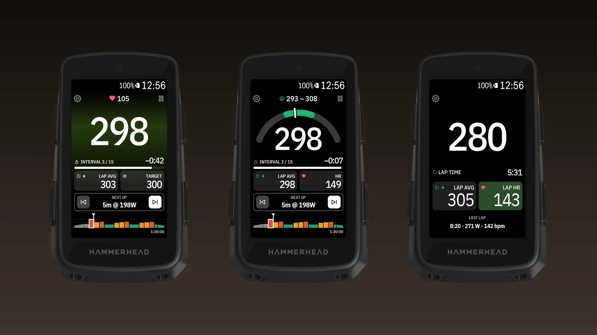
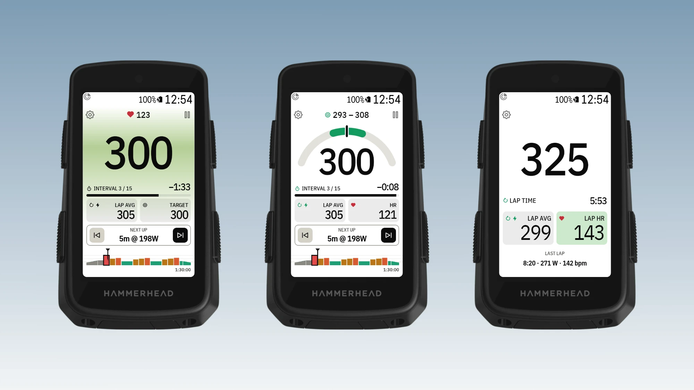

# Interval Screen for Karoo 3

> **Stride fork.** This version loads planned workouts from [Stride](https://stride.is) instead of
> intervals.icu. On the Karoo: open **Interval Screen Stride**, tap the person icon and paste a Stride
> API token (stride.is → Settings → API, read access; needs an active Stride trial or subscription).
> FTP is optional: left empty, it is worked out from Stride's planned power. Rides recorded on the
> Karoo reach Stride through Stride's own Hammerhead integration. It installs next to the original
> app (separate app and extension ID). APK: Actions tab → latest "Build APK" run → artifact.


A full-page data field for the Hammerhead Karoo 3 that makes structured workouts easy to follow.
It loads your planned workouts from [intervals.icu](https://intervals.icu) and runs them itself, so
you can jump forward **and back** between intervals.




- **Big 3-second power:** tap the watts to change how the target range shows: plain, coloured
  number, coloured background, both, or a **power gauge**. Blue is below the range, green in it,
  red above it.
- **Interval, time left and progress bar,** with lap average and target (tap Lap avg for Lap NP,
  tap Target for the range) and heart rate.
- **Next up with ⏮ / ⏭:** a jump starts a 5-second countdown with beeps, so you can get ready.
- **The whole workout as a chart** in zone colours with a "now" marker; tap it to zoom in.
- **Pause** stops the interval timer (for traffic, say) while the ride keeps recording. One lap per
  interval in your ride file, and short beeps before each interval ends.
- **Without a workout:** big watts, lap time, lap average and heart rate (tap HR for the lap's
  average), and the last lap.
- **Karoo style** (Settings): the Karoo's own fonts, field sizes and colours. **Dark / Light / Auto**
  follows the Karoo or stays fixed.
- **Remote button actions:** next interval, previous interval, pause or resume the workout.

Values show `--` when a sensor isn't connected. There's a step-by-step
[guide with pictures](docs/guide/README.md) for every feature.

Developers: read `../CLAUDE.md` (the Karoo playbook) first.

## Install on your Karoo

1. On your phone, open the latest [release](../../releases/latest) and share the `.apk` download
   link to the **Hammerhead Companion** app. It installs the app on your paired Karoo.
   (With a computer: `adb install interval-screen.apk`.)
2. On the Karoo, open **Interval Screen** from the app list, tap the person icon and enter your
   intervals.icu API key (intervals.icu → Settings → Developer settings). Keep Athlete ID `0`.
3. Pick a workout from this week's list.
4. In a ride profile, add a page with one field and choose **Interval Screen → Interval screen**.
5. Optional: assign *Next interval*, *Previous interval* and *Pause or resume workout* to remote buttons.

Syncing uses the Karoo's Wi-Fi, or your phone through the Companion app. Your API key is stored
only on the Karoo.

Don't also start the same workout in Karoo's own workout player: this app marks a lap at every
interval change, which would move Karoo's player along too.

## Build it yourself

1. Install [Android Studio](https://developer.android.com/studio) and run its setup wizard
   (**Standard**), which installs the Android SDK.
2. Open this folder in Android Studio and run it on a Karoo connected over USB (developer mode and
   USB debugging on). Or from a terminal:
   ```bash
   ./gradlew :app:installDebug
   ```
   If Gradle can't find Java, use Android Studio's: on macOS
   `JAVA_HOME="/Applications/Android Studio.app/Contents/jbr/Contents/Home"`.

Debug builds (what Android Studio's Run button installs) show **demo data**: made-up power, heart
rate and laps that change every 3 seconds, around a 300 W target, so the screens can be checked
without riding. It lives in `app/src/debug/`; release builds use `app/src/release/`, which passes
real data straight through, so demo data never ships.

Build output goes to `build.nosync/` folders, which iCloud Drive skips, since a synced Documents
folder otherwise creates "file 2" copies that break the build.

Only install while no ride is recording: Karoo doesn't restart a field's view mid-ride, so the
screen freezes until the ride screen is reopened.

No GitHub token is needed. The Karoo SDK (karoo-ext 1.1.9, Apache 2.0) is included as source in
`karoo-ext/`.

## Publishing a release

Releases must always be signed with the **same key**, or Karoos with an older version can't update.

1. Create the key once (Android Studio → Build → Generate Signed App Bundle or APK → Create new),
   saved **outside** this folder, e.g. next to it as `karoo-interval-release.jks`. Back it up.
2. Copy `keystore.properties.example` to `keystore.properties` and fill in the passwords. Both
   files are git-ignored.
3. Raise `versionCode` and `versionName` in `app/build.gradle.kts`.
4. Build and publish:
   ```bash
   ./gradlew :app:assembleRelease
   cp app/build/outputs/apk/release/app-release.apk interval-screen.apk
   gh release create v0.1.0 interval-screen.apk --title "v0.1.0" --notes "What changed"
   ```

Without `keystore.properties`, release builds fall back to the debug key: fine for testing, but
don't publish those.

## Code map

| File | What it does |
| --- | --- |
| `IntervalExtension.kt` | Entry point Karoo binds to; remote button actions |
| `WorkoutSession.kt` | Workout engine: clock, steps, jump countdown, pause, lap average, sensor data |
| `IntervalDataType.kt` | The data field; redraws once a second, right away for countdown numbers |
| `ScreenRenderer.kt` | Builds the field (workout screen and free-ride screen) |
| `ChartRenderer.kt` | Draws the workout chart and the list thumbnails |
| `IntervalsIcu.kt`, `KarooHttp.kt` | intervals.icu client, requests through the Karoo's connection |
| `PlanStore.kt` | Selected workout, API key, synced week, saved progress (app-private storage) |
| `SetupActivity.kt`, `AccountActivity.kt` | Workouts page and Account page |
| `res/layout/field_interval.xml`, `field_free.xml` | Field layouts, sized for a Karoo 3 full page |

## Things learned on the device

- Karoo 3: Android 12 (API 32), 480×800 at 300 dpi; a full-page field is 478×721 px.
- A loaded route makes the field shorter without telling the app, so the watts size themselves to
  the space they get.
- Taps in the top ~20 px of a field don't reach the app (Karoo's swipe-down area).
- Field layouts may only use RemoteViews widgets (no plain `View`), and update at most once a second.

## Licence

MIT, see `LICENSE`. The included Karoo SDK in `karoo-ext/` is Apache 2.0, see `karoo-ext/LICENSE`.
