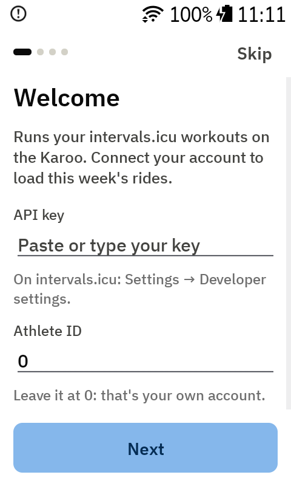
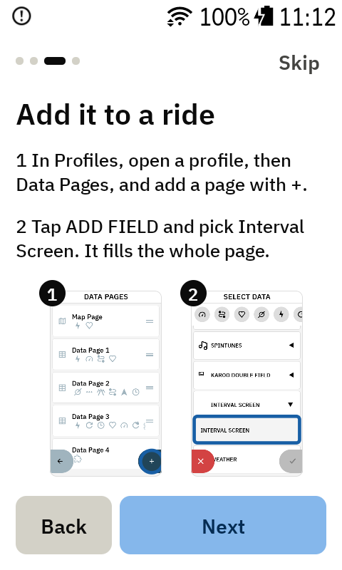
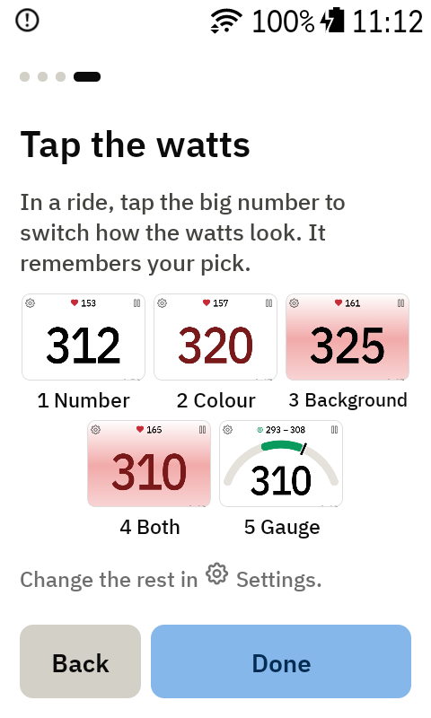

# Getting started

Interval Screen loads your planned workouts from [intervals.icu](https://intervals.icu) and runs
them itself on the Karoo, so you can move forward **and back** between intervals.

## 1. Install the app

On your phone, open the latest [release](https://github.com/Dubadai/karoo-interval/releases/latest)
and share the `interval-screen.apk` download link to the **Hammerhead Companion** app. It installs
the app on your paired Karoo.

Updating works the same way, and keeps your settings and API key: see [Updating the app](updating.md).

## 2. The introduction

The first time you open **Interval Screen** from the Karoo's app list, four short pages walk you
through the setup. **Skip** (top right) jumps past them; everything stays changeable later in
[Settings](settings.md), which can also show the introduction again.

### Connect intervals.icu

Enter your intervals.icu API key. You find it on intervals.icu under **Settings → Developer
settings**. Leave **Athlete ID** at `0`, which means your own account, and tap **Next**. Your API
key is stored only on the Karoo. No key yet? Tap **Next** anyway and add it later in
**Settings → intervals.icu account**.

### Choose a look

**Appearance** (Dark / Light / Auto) and **Karoo style** (Off / On), the same as in
[Settings](settings.md). The page itself changes as you tap.

### Add it to a ride

1. On the Karoo, open **Profiles**, pick a profile, then **Data Pages**, and add a page with **+**.
2. Tap **ADD FIELD** and pick **Interval Screen → Interval Screen**.

The screen fills the whole page. With a route loaded the Karoo makes the field a bit shorter, and
the watts shrink to fit.

### Tap the watts

During a ride, **tap the big watts number** to switch how it looks: Number, Colour, Background,
Both, Gauge, then back to Number. The app remembers your pick. See
[Watts colours and the power gauge](watts-colours.md).

## 3. Pick a workout

**Pick a workout** on the last page opens the **Workouts** page and syncs. Pick a workout from this
week's list; the app goes straight back to the ride screen. See
[Workouts and Account](workouts-and-account.md) for more.

## 4. Changing it later

Tap ⚙ on the ride screen, then ⚙ on the Workouts page, for [Settings](settings.md): Appearance,
Karoo style, your intervals.icu account, and **Show introduction**.

## 5. Optional: remote buttons

In the Karoo's controller settings you can assign these to remote buttons:

- **Next interval** and **Previous interval**: the same as tapping ⏭ / ⏮ on the screen. See
  [Jumping between intervals](jumping.md). A choice made with a remote confirms itself after
  5 seconds, so you don't need to touch the screen.
- **Pause or resume workout**: see [Pausing the workout](pausing.md).

## Good to know

- Don't also start the same workout in the Karoo's own workout player. Interval Screen marks a
  lap at every interval change, which would move the Karoo's player along too.
- Syncing uses the Karoo's Wi-Fi, or your phone through the Companion app.
