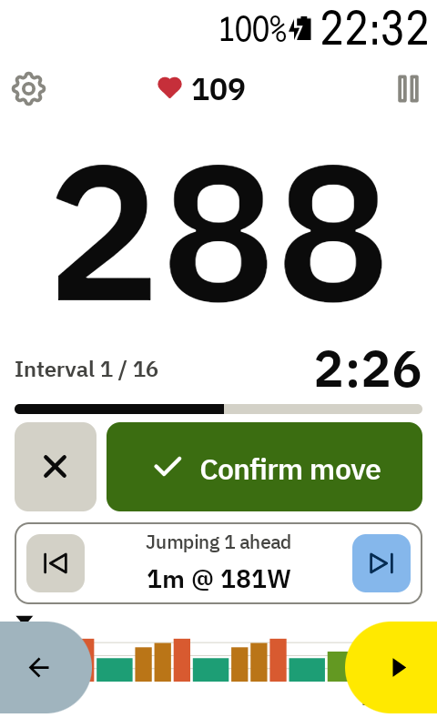
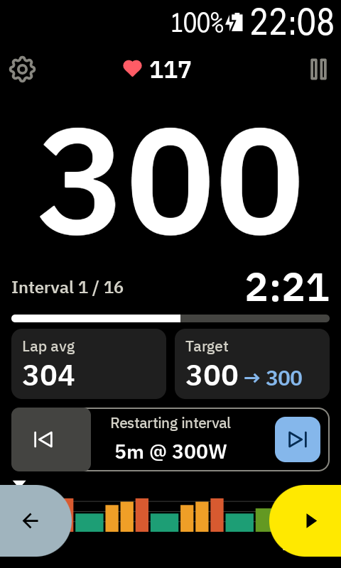
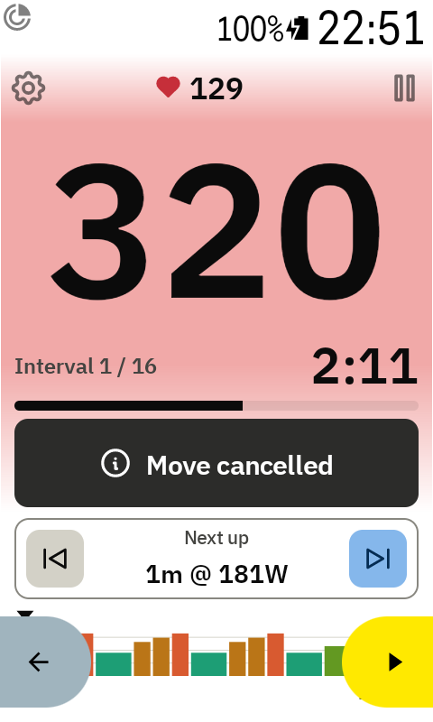
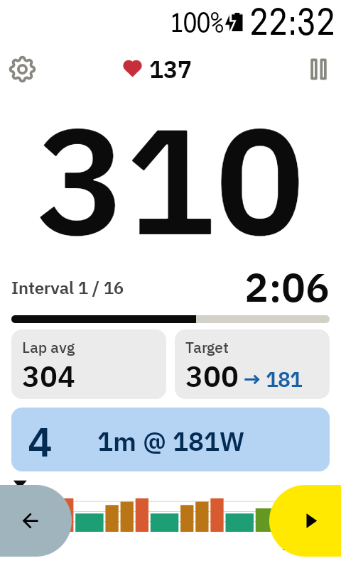

# Jumping between intervals

Use ⏮ and ⏭ in the **Next up** box to skip an interval, go back, or restart the one you're in.
Nothing changes until you confirm, so a bumped button never moves you by mistake.

## 1. Choose where to go

Each tap on ⏭ or ⏮ moves your choice one step. The box tells you what will happen:

- **Jumping 1 ahead**, **Jumping 2 ahead**, …
- **Restarting interval**: one tap on ⏮ starts the current interval again
- **Jumping 1 back**, …

The chart shows the whole workout and marks your choice with a blue bar and a ▼ (purple with
[Karoo style](settings.md)). The Target tile shows the watts you'd land on after an arrow
(**300 → 181**).

 

## 2. Confirm or cancel

While you choose, the tiles are replaced by two buttons:

- **Confirm move** (right, just above ⏭): makes the jump.
- **✕** (left): cancels. You stay where you are, and **Move cancelled** shows for 3 seconds. Tap
  it to hide it sooner.

You can also cancel by tapping ⏮ / ⏭ back to the interval you're in. If you don't do anything for
10 seconds, the choice cancels itself.

## 3. Get ready

After **Confirm move**, a 5-second countdown with beeps gives you time to get ready, then the new
interval starts. Your lap is marked at that moment. The box shows the seconds left on the left and
the interval you're jumping to on the right, and fills up as the seconds run down (blue, or the
Karoo's workout purple with Karoo style, where **Confirm move** is Karoo yellow).

Can't wait? Tap the countdown, or press ⏭ / ⏮, to start right away. Once confirmed, the jump
always happens.

## Remote buttons

**Next interval** and **Previous interval** on a remote work like ⏭ and ⏮: they choose where to
go. You don't need to touch the screen:

- **Confirm move** fills up and counts down from 5 (**Confirming… 5**). When it's full, the move
  is confirmed by itself and the usual 5-second countdown starts.
- Press again to go further. The fill starts over.
- To cancel, press the opposite button until you're back where you are, or tap ✕.
- While the countdown runs, a press on either button jumps right away.

Choices made by tapping ⏭ / ⏮ on the screen don't confirm themselves: tap **Confirm move**.
