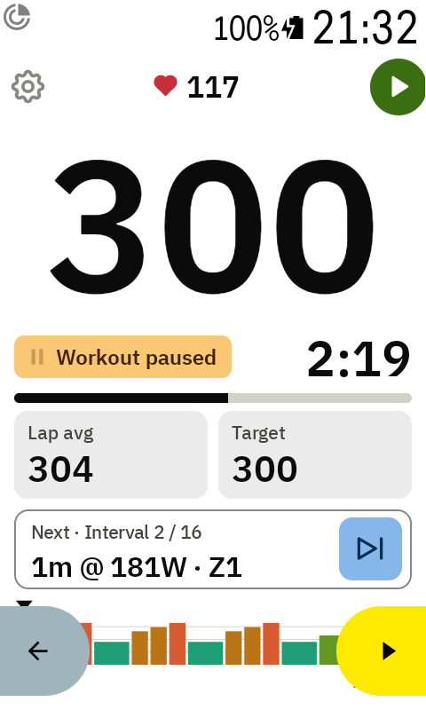

# Pausing the workout

Stopped at a traffic light or a café? Pause the workout so the interval doesn't run out.

## Pause and resume

1. Tap ⏸ in the top right corner (or use the remote button **Pause or resume workout**).
2. A yellow **Workout paused** box replaces the interval number. Its icon blinks.
3. ⏸ turns into a large green ▶ button (Karoo yellow with [Karoo style](settings.md)). Tap it to
   carry on where you stopped.
4. The ⏭ button turns grey and can't be tapped, so the play button is the one to press.

Pausing stops only the interval timer. **The ride keeps recording**, and the lap average keeps
counting.

## When the Karoo pauses the ride

If the Karoo pauses the ride itself, for example with auto-pause, the box says **Workout
auto-paused**. There's no resume button then: the workout carries on when the ride does. ⏭ is
grey here too.
