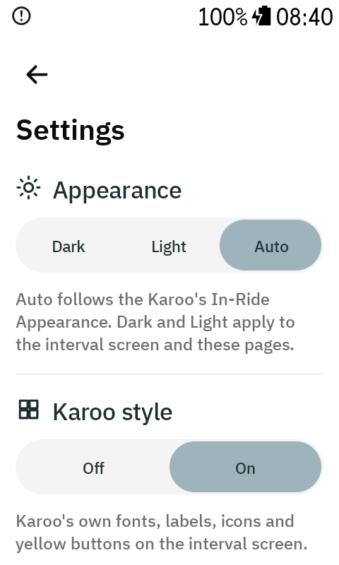
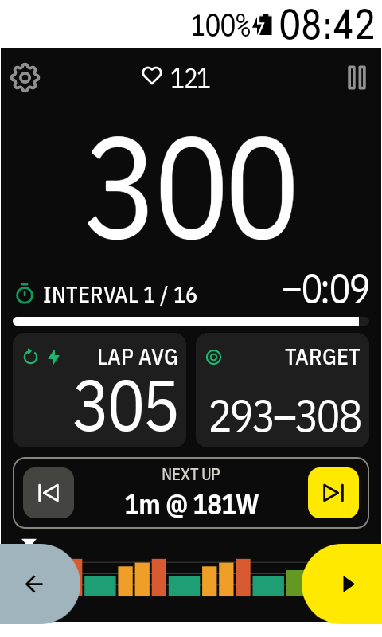
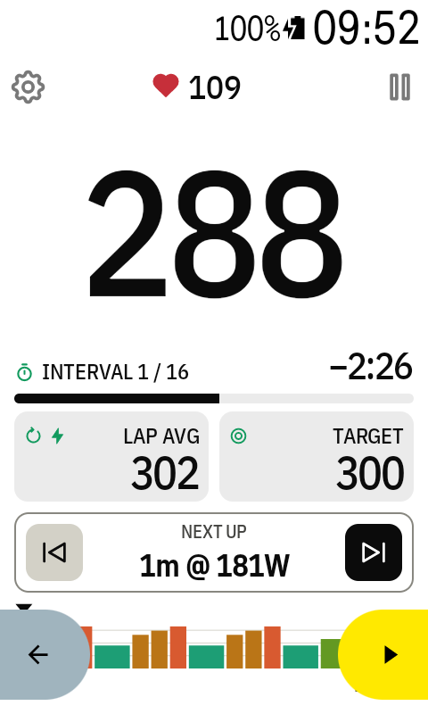
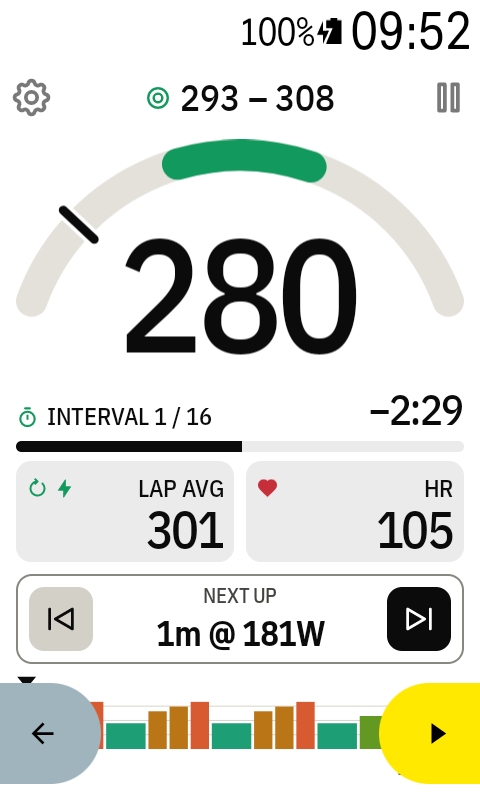
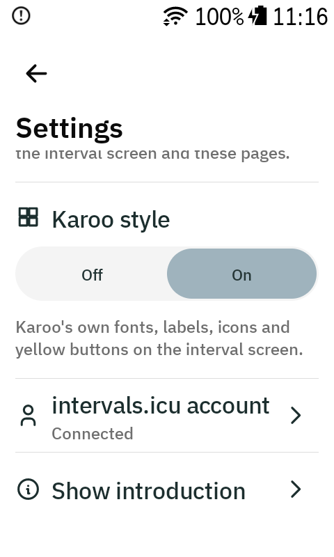

# Settings

Open the **Workouts** page (⚙ on the ride screen), then tap ⚙ in its top right corner.

## Appearance

**Dark / Light / Auto**, like the Karoo's own *In-Ride Appearance*.

- **Auto** (default): follows the Karoo's In-Ride Appearance.
- **Dark** or **Light**: the interval screen and the app's pages always use that mode, whatever
  the Karoo is set to. The Karoo's own top bar keeps its colours.

## Karoo style

**Off / On**. On makes the interval screen look like the Karoo's own data pages:

- Karoo's fonts: condensed uppercase labels, and numbers in the same font as Karoo's fields.
- Everything under the watts is one compact block that looks the same on every screen, so the
  watts are always the biggest thing: Lap avg and Target (or HR on the gauge) with small green
  icons, which turn black on the coloured background (white in dark mode).
- All numbers share one weight; the watts are simply the biggest.
- The resume button is Karoo yellow. ⏭ is black (white in dark mode), so the Karoo's own yellow
  buttons and route pill stand out.

 

Both settings apply right away, also during a ride.

## intervals.icu account

Opens the [Account page](workouts-and-account.md#account) with your API key and athlete ID.

## Show introduction

Shows the four introduction pages again (connect, look, adding the screen to a ride profile,
tapping the watts). **Done** on the last page brings you back here.

