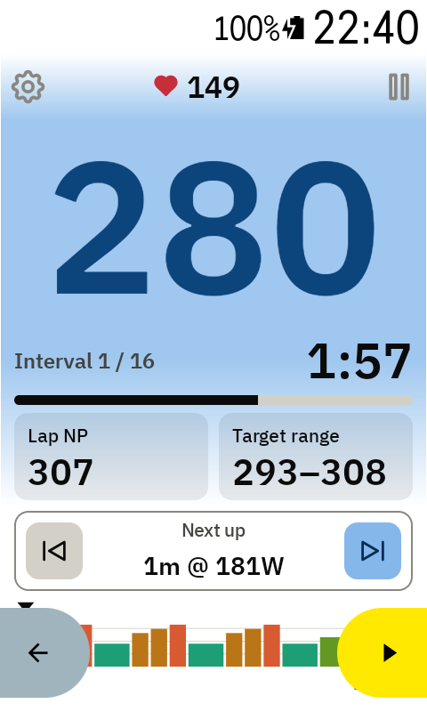
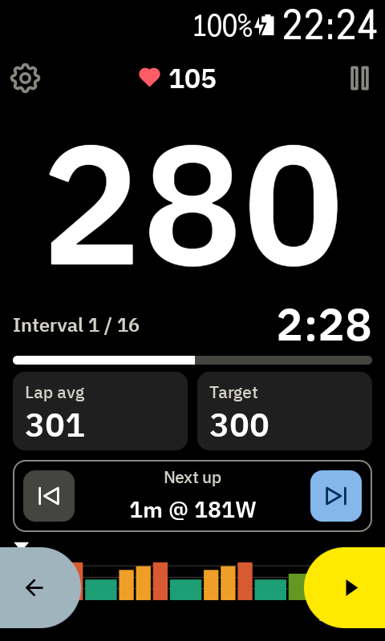
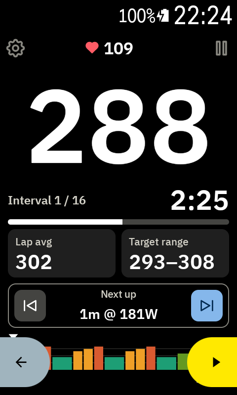

# Lap NP and Target range

The two tiles under the progress bar can each show one of two things. Tap a tile to switch. The
Karoo remembers your choice between rides.

## Lap avg ↔ Lap NP

- **Lap avg**: your average power in this interval.
- **Lap NP**: your normalised power in this interval. It weighs hard surges more than an average
  does, so it shows better how tough an uneven interval really was.

Lap NP needs 30 seconds of riding, so it shows `--` at the start of each interval.

The same switch works on the [free-ride screen](free-ride.md), using the Karoo's own lap.

## Target ↔ Target range

- **Target**: the watts for this interval, for example `300`.
- **Target range**: the range you should stay in, for example `293–308`. It's the same range the
  [watts colours](watts-colours.md) use. On ramps it moves with the target.

 
