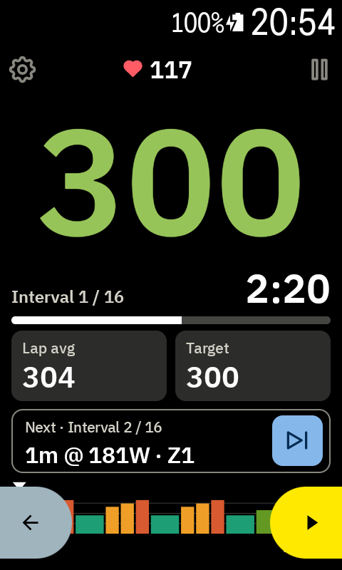
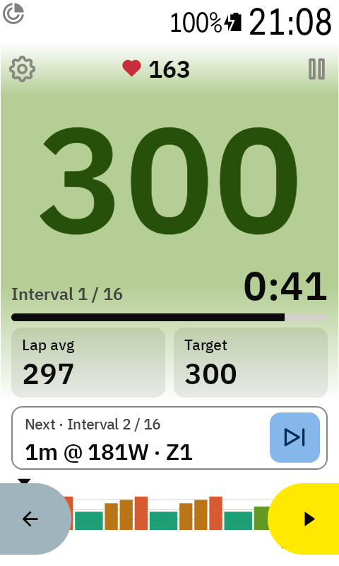
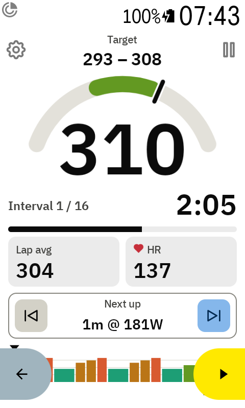

# Watts colours and the power gauge

The colours tell you at a glance whether you're on target:

- **Blue**: below the target range
- **Green**: in the range
- **Red**: above the range

The range is the interval's own range from intervals.icu (±2.5% by default), or ±3% if the
interval has none. The colours follow 3-second power.

## Choose how the colours show

Tap the big watts number to go through five styles:

1. **Plain**: no colour
2. **Coloured number**
3. **Coloured background**: a soft tint behind the watts
4. **Both**
5. **Power gauge**: see below

The Karoo remembers your choice between rides.

 

With a coloured background, the tiles, progress bar and corner icons are see-through, so they
take on the tint too.

There's no colour while the workout is paused, after it ends, or without a power meter or target.

## Power gauge

The fifth style turns the watts into a gauge: a grey arc with the target range in green, and a
needle at your 3-second power. The target range moves to the top of the screen, and the right tile
shows your heart rate instead of the target. The interval time and the tiles stay where they are.

The arc reaches well past the range on both sides (four times the range, and at least ±10% of the
target), so the green part is about a quarter of the arc. Past either end, the needle stops at the
edge. Tap the watts again to go back to plain.

With a route loaded the screen is shorter, so the arc gets flatter and wider instead of shrinking,
and the watts stay big.
