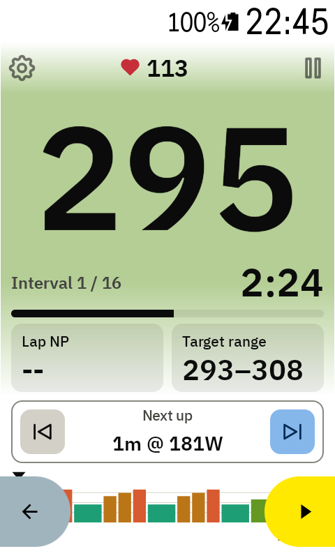
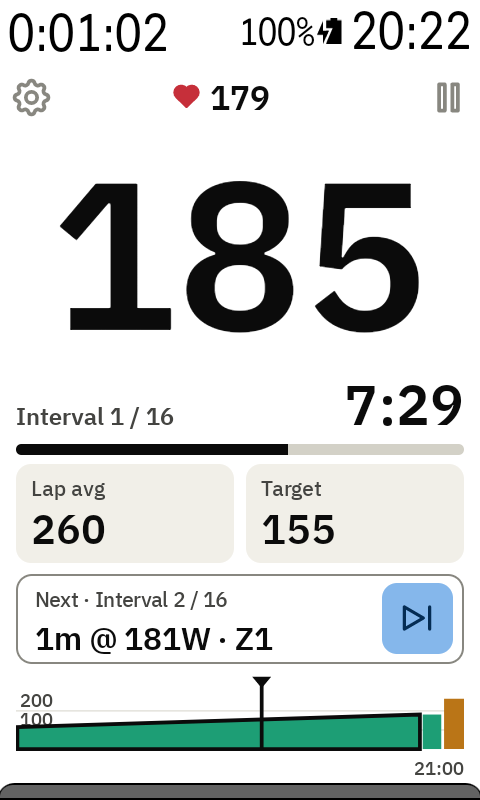
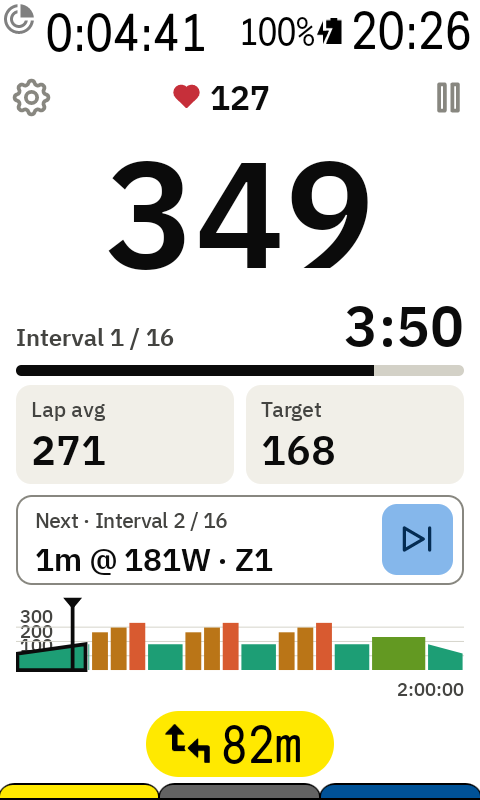

# The workout screen

From top to bottom:

| Part | What it shows |
| --- | --- |
| ⚙ (top left) | Opens the [Workouts page](workouts-and-account.md) |
| ❤ number | Heart rate |
| ⏸ (top right) | [Pauses the workout](pausing.md) |
| Big number | 3-second power. Tap it to [change the colours](watts-colours.md) |
| Interval 1 / 16 | Which interval you're in, out of how many |
| Time | Time left in this interval, counting down (−2:18) |
| Bar | How much of the interval is done |
| Left tile | Lap avg or [Lap NP](tiles.md) for this interval |
| Right tile | Target or [Target range](tiles.md) for this interval |
| Next up | The next interval's length and watts, with ⏮ / ⏭ to [jump](jumping.md) |
| Chart | The whole workout |

## The chart

Each bar is one interval, in its power zone colour. Finished intervals turn grey, and a black
marker shows where you are. The end time of the workout is on the right.

Tap the chart to zoom in on the current interval. Tap again to see the whole workout.

## Laps and beeps

- Every interval is its own lap in your ride file, so intervals.icu and Strava show them
  separately.
- Short beeps play in the last 3 seconds of each interval.

## With a route

When you follow a route the Karoo shows the route under the field and makes it shorter. The
watts shrink to fit; everything else stays the same.

