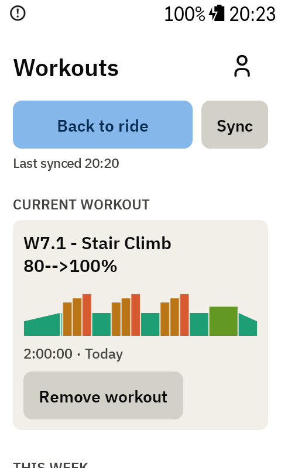
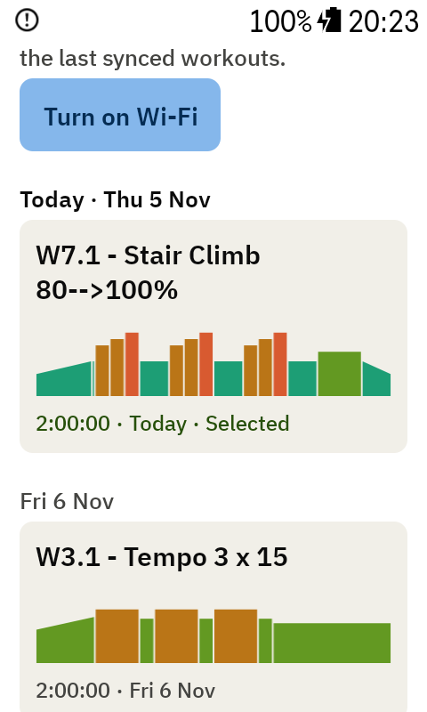
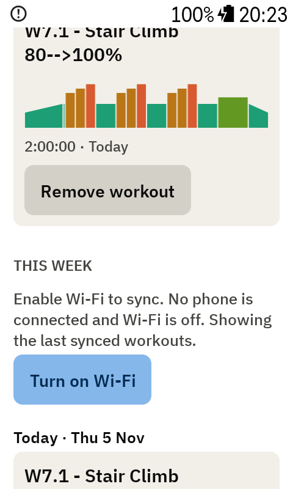
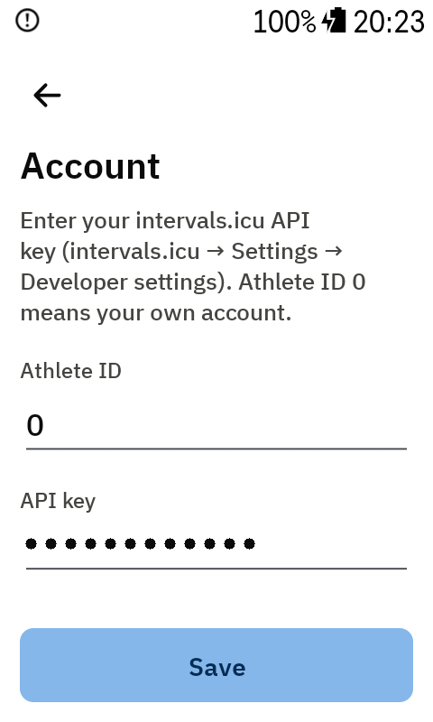

# Workouts and Account

Open the **Workouts** page with ⚙ on the ride screen, or open **Interval Screen** from the Karoo's
app list. ⚙ on the Workouts page opens [Settings](settings.md).

## Workouts

 

- **Sync** loads this week's planned workouts from intervals.icu. The page shows when it last
  synced.
- Each card shows the workout's name, its shape in zone colours, its length and its day.
- Tap a card to pick it. You go straight back to the ride screen.
- **Remove workout** takes the current workout off, so the ride screen shows the
  [free-ride screen](free-ride.md).
- **Back to ride** returns to the ride without changes.

The app never picks a workout by itself.

## Offline

Syncing goes through the Karoo, over Wi-Fi or your phone. Without either, the page says **Enable
Wi-Fi to sync** with a **Turn on Wi-Fi** button. It syncs by itself as soon as Wi-Fi connects. The
last synced week stays available offline.

## Account

On the Workouts page, tap ⚙, then **intervals.icu account**. The row says **Connected** once a
key is saved.

- **API key**: from intervals.icu under **Settings → Developer settings**. It's hidden as you
  type and stored only on the Karoo.
- **Athlete ID**: leave it at `0` for your own account.

